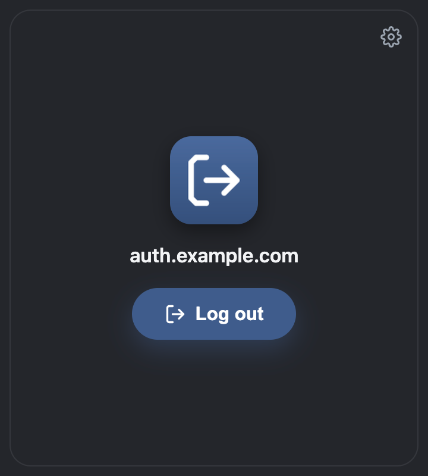
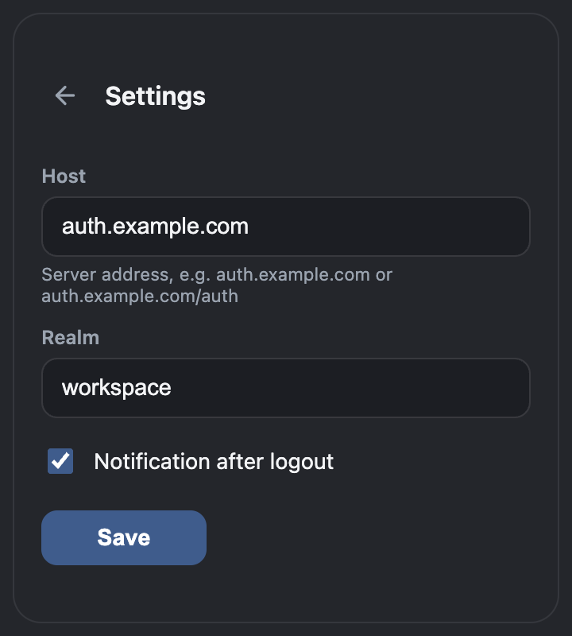

# Keycloak Logout

A browser extension that ends a Keycloak (SSO) session in one click. It opens
the logout page in a background tab, confirms the logout there, and closes the
tab once Keycloak reports that you are logged out. If the logout cannot be
confirmed, the tab comes to the front and a notification says so. Works with any
Keycloak server; the address and realm are set in the extension settings.

<p>
  
  
</p>

## Project Structure

```text
.
├── .github/workflows/ci.yml      # checks, zip build, install test, releases
├── VERSION                       # current version
├── CONTRIBUTING.md               # development setup and releases
├── LICENSE                       # MIT
├── package.json                  # dev tooling only (Playwright for the e2e test)
├── docs/images/                  # images used in this README
├── extension/                    # the extension, loaded into the browser as is
│   ├── manifest.json
│   ├── background/               # runs the logout: tab, timeout, notifications
│   ├── content/                  # Keycloak page recognition and auto-confirm
│   ├── common/                   # settings validation, logout URL and saving
│   ├── popup/                    # window with the Log out button and settings
│   └── icons/
├── scripts/build.sh              # builds keycloak-logout.zip and checksums
├── tests/                        # unit tests, no dependencies
└── e2e/                          # end-to-end test against a real Keycloak
```

## Installation

Works in Chrome, Edge, Yandex Browser, and Chromium-GOST (Chromium 102 or
newer). Download the latest release and unpack it into `~/keycloak-logout`; the
browser loads the extension from this folder on every start.

On macOS or Linux:

```bash
curl -fLO https://github.com/vitlixe/keycloak-logout/releases/latest/download/keycloak-logout.zip && unzip -oq keycloak-logout.zip -d ~ && rm keycloak-logout.zip
```

On Windows (PowerShell):

```powershell
Invoke-WebRequest https://github.com/vitlixe/keycloak-logout/releases/latest/download/keycloak-logout.zip -OutFile keycloak-logout.zip; Expand-Archive keycloak-logout.zip $HOME -Force; Remove-Item keycloak-logout.zip
```

Then load it into the browser:

1. Open the extensions page: `chrome://extensions` in Chrome and Chromium-GOST,
   `edge://extensions` in Edge, `browser://extensions` in Yandex Browser.
2. Turn on **Developer mode** and click **Load unpacked**.
3. Select the `keycloak-logout` folder in your home folder.

Update with the same command, then click **Reload** on the extension card; the
settings are kept. Loading it from another folder installs it as a new
extension with empty settings.

For a specific version, replace `latest/download` with `download/vX.Y.Z`
(available from v0.2.0). Each release also has `checksums.sha256` for
`sha256sum -c`. The installed version is shown on the extension card and stored
in `~/keycloak-logout/VERSION`.

## Configuration

Open the extension popup and click the gear icon to edit settings. Clicking
**Log out** before the settings are filled in opens them instead.

Click **Save** and allow access when the browser asks. Access is requested only
for the server's exact hostname, without granting its subdomains. If you decline,
the previous settings are kept. Saving a different server removes the old
server's permission.

After updating from a version that had access to all HTTPS sites, save the
settings once to grant access to your Keycloak host. If access is revoked in the
browser, **Log out** opens settings so you can grant it again. Settings sync
between devices; site permissions must be granted separately in each browser.

| Setting | Example | Description |
|---|---|---|
| Host | `auth.example.com` | Keycloak server address. A port and a path prefix are allowed: `auth.example.com:8443`, or `auth.example.com/auth` for Keycloak older than 17. A leading `https://` is removed; other schemes are rejected. |
| Realm | `master` | Realm name. It is URL-encoded, so names with `#` or spaces work. |
| Notification after logout | on | Show a notification after a successful logout. Failures are always reported. |

The logout URL is built from these settings:

```text
https://<host>/realms/<realm>/protocol/openid-connect/logout
```

## Usage

1. Click the extension icon, then **Log out**.
2. The logout page opens in a background tab and the confirmation is submitted
   automatically.
3. When Keycloak shows its "logged out" page, the tab closes and a notification
   confirms the logout.

If anything else happens (an error page, an unknown page, an unreachable
server, a redirect elsewhere, or no result within 15 seconds), the logout counts
as failed: the tab stays open and comes to the front, and a notification says
the logout was not confirmed. Check the tab and the settings.

Only one logout runs at a time; clicking **Log out** again while it runs does
nothing.

## Security Notes

- Site access is optional and requested when you save the Keycloak server.
  Installation does not grant access to any websites. Only the configured
  hostname is requested; previous server grants and legacy all-site access
  are removed. Browsers grant all HTTPS paths and ports on that hostname, so
  the logout endpoint is additionally checked in code.
- That access is used only for the logout tab: scripts run only in the tab the
  extension opened itself, and only while it shows the logout endpoint of the
  configured server.
- The extension submits only Keycloak's own confirmation form: a POST form to
  `.../logout/logout-confirm` of the same realm with a `session_code` field.
  Other forms on the page are never submitted.
- A logout is reported as successful only on Keycloak's "logged out" page.
  Recognition follows Keycloak's standard login theme; with a custom theme that
  drops its element ids or the `session_code` field, the extension reports a
  failure rather than a false success.
- Settings are kept in the browser's sync storage and travel with the browser
  account when sync is on. The extension stores no passwords or tokens and
  sends nothing anywhere except the Keycloak server.
- Logging out ends the Keycloak session. Applications that keep their own
  session stay signed in until they check it again, unless back-channel logout
  is configured for them in Keycloak.

## License

MIT. See [LICENSE](LICENSE).
